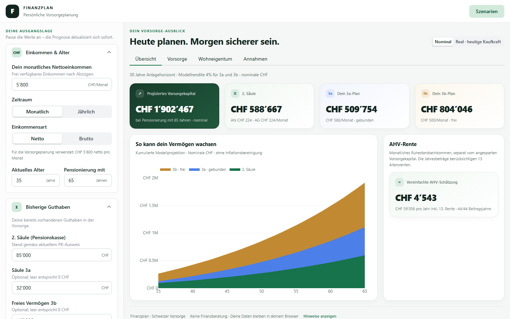
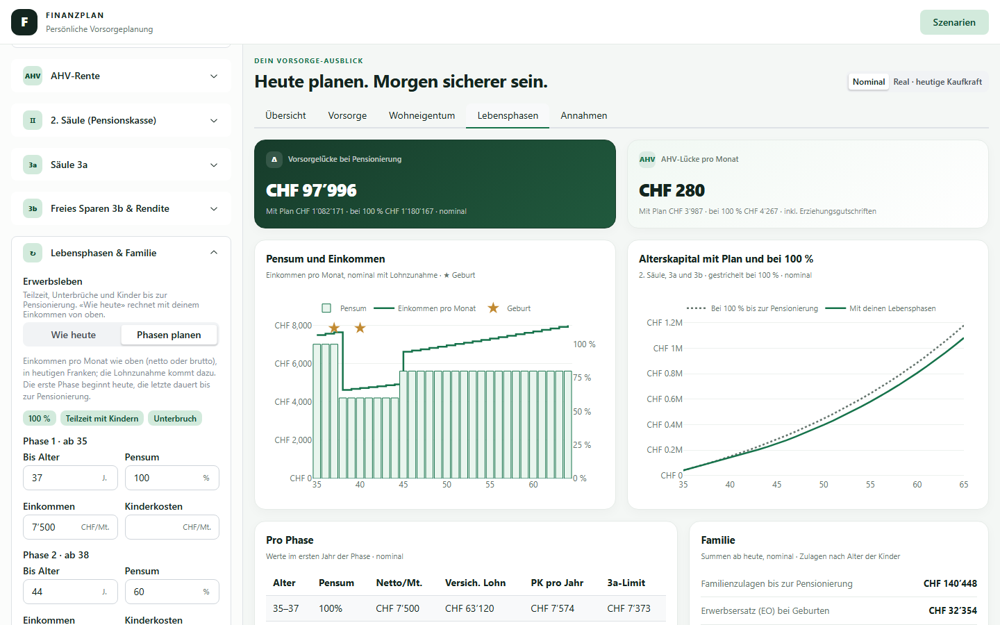

# Swiss Personal Finance Planner

[](https://github.com/NickHostettler/my-finance-planner/actions/workflows/ci.yml)


> **Personal project by Nick Hostettler.** Published for viewing only; see [LICENSE](LICENSE).

A web app that projects how Swiss retirement savings could develop until retirement: the
occupational pension (2nd pillar/BVG), tax-advantaged pillar 3a, free savings (3b), and a rough
AHV state-pension estimate. Since v1.1 it also checks whether a planned home purchase is
affordable and what it does to the retirement savings; since v1.2 it shows what part time,
career breaks and children do to the pension compared with working full time. It is deployed
for a small group of friends: each one uses it in their own browser, and **no personal
financial data is ever stored on the server**.






### Highlights

- **Privacy by design:** All user data (scenarios, last inputs) lives only in the user's browser
  (`localStorage`). The server is stateless; it never writes to disk, caches, or logs user input.
  Verified by isolation tests, a deliberately injected data leak that the tests catch, and
  end-to-end tests with two separate browser profiles.
- **Secure deployment:** Dockerized (multi-stage build, non-root user, read-only filesystem) and
  served by gunicorn on Render's free tier. The shared-password login (HTTP Basic Auth,
  constant-time comparison) **fails closed**: the container refuses to start without a password.
- **CI/CD:** GitHub Actions runs linting, a format check and 700+ tests (100 % line and branch
  coverage) on Linux and Windows, Playwright
  browser tests and a Docker build with smoke tests on every pull request. Render deploys only
  commits whose checks passed.
- **Domain logic:** Swiss salary deductions with 2026 rates (AHV/IV/EO, ALV with its insured-salary
  cap), BVG estimate, AHV pension scale, BVG and 3a limits valid from 2027, 2nd-pillar
  contributions that grow with the salary year by year, compound-interest projections in nominal
  or real terms.
- **Home ownership (v1.1):** affordability and equity check following the Swiss banking rules
  (20 % equity, 10 % of it not from the pension fund, housing costs up to a third of the gross
  income) with a traffic light and the maximum affordable price; early withdrawals from the
  2nd pillar and 3a (WEF) and their effect on the retirement capital; direct or indirect
  amortisation, net wealth over time and affordability in retirement. The purchase money is
  prefilled with the most the projection allows at the purchase age (v1.1.1), next to the
  highest price that all available money would allow. Every rule is a constant with its source.
- **Life phases and family (v1.2):** the working life in phases with their own workload and
  income; the 2nd pillar follows the BVG rules for part time (entry threshold, coordination
  deduction fixed or by workload), pillar 3a switches to the large limit without a pension
  fund, the AHV estimate counts lower incomes and education credits. Children bring family
  allowances, parental leave (EO) and child costs. The result is the pension gap in CHF
  compared with full time, and every other tab follows the plan.
- **Clean architecture:** `core/` (pure domain logic) → `storage/` → `dashboard/` (UI);
  dependencies only point inwards.

**Tech stack:** Python 3.14 · Dash · Dash Mantine Components · Plotly · Flask · gunicorn · Docker ·
Render · GitHub Actions ·
pytest · Playwright · uv · ruff

**Workflow:** Every change went through an issue, a feature branch and a reviewed pull request
with green CI (milestones [v1.0](https://github.com/NickHostettler/my-finance-planner/milestone/1),
[v1.1](https://github.com/NickHostettler/my-finance-planner/milestone/2) and
[v1.2](https://github.com/NickHostettler/my-finance-planner/milestone/3),
[releases](https://github.com/NickHostettler/my-finance-planner/releases)).
Developed with the help of an AI coding assistant (Claude Code), which is noted in the commit
messages.

---

*Die weitere Dokumentation ist auf Deutsch.*

Ein Python-Paket für private Finanzplanung nach dem Schweizer Rentensystem (1., 2. und 3. Säule).

## Features

- **Nettolohn Input**: Einfache Eingabe des monatlichen Nettolohns
- **2. Säule Berechnung**: Automatische Berechnung des Berufsvorsorgeanspruchs (BVG-konform)
- **3a Szenarien**: Mehrere Sparlösungen für die 3. Säule
- **Feste Beträge**: Feste monatliche Beiträge für 3a und 3b; ein Button setzt den höchsten 3a-Betrag im Modell-Limit ein
- **Lohnzunahme**: Eine jährliche Lohnzunahme lässt die Beiträge an die 2. Säule Jahr für Jahr steigen
- **Dash Dashboard**: Interaktive Visualisierung und Vermögensanalyse
- **Live-Planung**: Monatliches oder jährliches Brutto-/Nettoeinkommen, flexible 3a/3b-Beiträge und Renditeannahmen mit interaktiven Prognosegrafiken; Brutto wird anhand des gewählten Kantons vereinfacht netto geschätzt
- **2. Säule**: Vereinfachtes BVG-Schätzmodell (keine offizielle Mindestberechnung) oder eigene monatliche Arbeitnehmer-/Arbeitgeberbeiträge und PK-Verzinsung
- **Startguthaben**: Bereits vorhandene Guthaben in der 2. Säule, 3a und 3b fliessen in die Projektion ein
- **Transparente Modellannahmen**: Renditen, nominale Werte ohne Inflationsbereinigung, Vereinfachungen der BVG-Schätzung und nicht berücksichtigte Faktoren werden bei der Prognose ausgewiesen
- **Wohneigentum**: Tragbarkeit und Eigenmittel mit Ampel, maximaler Kaufpreis, Vorbezug aus 2. Säule und 3a (WEF), direkte oder indirekte Amortisation, Nettovermögen und Tragbarkeit im Alter. Die Kaufmittel werden mit den Höchstbeträgen zum Kaufalter vorbelegt; daneben stehen der Eigenmittelbedarf und der höchste Kaufpreis mit allen verfügbaren Mitteln
- **Lebensphasen & Familie**: Erwerbsleben in Phasen mit Pensum und Einkommen (Vorlagen für Teilzeit mit Kindern und Unterbruch), Teilzeitregeln der 2. Säule mit fixem oder pensumabhängigem Koordinationsabzug, grosse 3a ohne Pensionskasse, AHV mit Erziehungsgutschriften, Familienzulagen, Erwerbsersatz bei Geburt und Kinderkosten; Vergleich mit 100 % als Vorsorgelücke in CHF
- **Nominale und reale Prognose**: Umschaltbare Anzeige in zukünftigen CHF oder kaufkraftbereinigten heutigen CHF unter Verwendung der konfigurierten jährlichen Inflation
- **AHV-Rente**: Unverbindliche Schätzung anhand des durchschnittlichen Jahreseinkommens und der Beitragsjahre als separates Ruhestandseinkommen; 13 Jahreszahlungen sind berücksichtigt, die AHV wird nicht zum Vorsorgekapital addiert
- **Szenarien im eigenen Browser**: Dashboard-Eingaben lassen sich benannt speichern, laden und löschen; ein erneut gespeicherter Name aktualisiert das bestehende Szenario. Die Daten bleiben im Browser des Nutzers, der Server speichert nichts
- **Zukunftsprognose**: Szenarioanalyse über einen konfigurierbaren Zeithorizont

## Installation

```bash
uv sync
```

## Verwendung

### Als CLI Dashboard starten:

```bash
uv run swiss-finance-dashboard
```

Das Dashboard öffnet sich automatisch im Standardbrowser unter `http://127.0.0.1:8050`,
sobald der Server bereit ist. Optionen:

```bash
uv run swiss-finance-dashboard --no-browser   # Browser nicht öffnen
uv run swiss-finance-dashboard --port 8080    # anderer Port
uv run swiss-finance-dashboard --debug        # Auto-Reload bei Codeänderungen (öffnet nur einen Tab)
```

`python -m personal_finance` akzeptiert dieselben Optionen.

### Produktionsbetrieb (Server/Container)

Auf einem Server läuft die App mit [gunicorn](https://gunicorn.org/) statt mit dem
Dash-Entwicklungsserver. gunicorn läuft nur unter Linux/macOS, also z.B. im Docker-Container,
und wird unter Windows nicht installiert.

```bash
gunicorn -c python:personal_finance.gunicorn_conf personal_finance.wsgi:server
```

| Umgebungsvariable | Standard | Bedeutung |
|---|---|---|
| `PORT` | `8050` | Port (setzen Hoster wie Render automatisch) |
| `HOST` | `0.0.0.0` | Interface |
| `WEB_CONCURRENCY` | `2` | Worker-Prozesse |
| `GUNICORN_THREADS` | `4` | Threads pro Worker |
| `LOG_LEVEL` | `info` | Log-Level |
| `APP_PASSWORD` | – | Gemeinsames Passwort (mind. 12 Zeichen); aktiviert den Login |
| `APP_USERNAME` | `kamerad` | Benutzername für den Login |
| `REQUIRE_AUTH` | `1` im Docker-Image | Start ohne `APP_PASSWORD` wird verweigert |

- `GET /health` antwortet mit `200 {"status": "ok"}` für die Health-Checks der Plattform.
- Der Debug-Modus ist im Produktionsbetrieb nie aktiv, und der Browser wird nicht geöffnet.
- Die Logs enthalten keine Eingabewerte und keine Client-IP-Adressen.

### Zugriffsschutz (Passwort)

Ist `APP_PASSWORD` gesetzt, fragt der Browser beim Öffnen nach Benutzername und Passwort
(HTTP Basic Auth über HTTPS). Öffentlich bleiben nur `/health` (für die Plattform) und
`/robots.txt`. Zusätzlich verbieten `robots.txt` und der Header `X-Robots-Tag` Suchmaschinen
das Indexieren.

- **Das Docker-Image startet nie ohne Passwort** (`REQUIRE_AUTH=1`). So kann die App nicht
  versehentlich offen online gehen. Lokal mit `uv run swiss-finance-dashboard` ist kein
  Passwort nötig; die App ist dort nur auf deinem Rechner erreichbar.
- Ein sicheres Passwort erzeugen:
  ```bash
  uv run python -c "import secrets; print(secrets.token_urlsafe(18))"
  ```
- Das Passwort gehört **nur** in die Umgebungsvariablen bzw. Secrets der Hosting-Plattform,
  nie ins Repository.
- Das Passwort hält Fremde fern, **trennt aber nicht zwischen den Kameraden**. Diese Trennung
  entsteht dadurch, dass die Daten nur im eigenen Browser liegen (siehe unten).
- Basic Auth hat kein „Abmelden“: Der Browser merkt sich den Login, bis er geschlossen wird.
  Auf fremden Geräten deshalb ein privates Fenster nutzen.

### Deployment auf Render

**Für Nutzer:** [Kurzanleitung](docs/ANLEITUNG.md) (Login, Bedienung, wo die Daten liegen).

Die App ist für [Render](https://render.com) (Gratis-Plan) vorbereitet. Die Konfiguration steht
in [`render.yaml`](render.yaml), die Einrichtung und der Betrieb sind in
[docs/DEPLOYMENT.md](docs/DEPLOYMENT.md) beschrieben. Deployt wird automatisch bei Merge auf
`main`, aber nur, wenn die CI grün ist.

### Mit Docker starten

Das [`Dockerfile`](Dockerfile) baut ein schlankes Produktions-Image: Python-Version aus
`.python-version`, Abhängigkeiten exakt aus `uv.lock`, gunicorn, eigener Benutzer ohne
root-Rechte und ein eingebauter `HEALTHCHECK`. Mit Docker Desktop lokal testen:

```powershell
$env:APP_PASSWORD = "ein-langes-test-passwort"
docker compose up --build        # -> http://localhost:8050  (Login: kamerad / Passwort)
```

oder ohne Compose:

```bash
docker build -t my-finance-planner .
docker run --rm -p 8050:8050 -e APP_PASSWORD="ein-langes-test-passwort" my-finance-planner
```

Der Container kommt mit schreibgeschütztem Dateisystem aus (`read_only` in
[`compose.yaml`](compose.yaml)), weil die App keine Daten auf dem Server speichert. Die CI baut
das Image bei jedem PR und prüft es auf diese Weise, inklusive Login und der Weigerung, ohne
Passwort zu starten.

### Wo werden meine Daten gespeichert?

Gespeicherte Szenarien und die zuletzt verwendeten Eingaben liegen **ausschliesslich im
`localStorage` deines Browsers** (Schlüssel `pf-scenarios` und `pf-last-inputs`). Der Server
rechnet nur. Er schreibt nichts auf die Festplatte, hält nichts im Speicher und loggt keine
Eingaben. Dadurch gilt:

- Jeder Nutzer sieht nur seine eigenen Daten, auch wenn alle denselben Server verwenden.
- Ein Neustart oder Deploy des Servers löscht keine Nutzerdaten.
- Die Daten sind an Gerät und Browserprofil gebunden. Wer dasselbe Profil nutzt, sieht sie.
  Löschen kannst du sie über „Löschen“ in der App oder die Websitedaten des Browsers.
- Die Daten werden im Browser nicht verschlüsselt.

Die letzten Eingaben werden automatisch gemerkt und beim nächsten Öffnen wiederhergestellt; sie
sind unabhängig von benannten Szenarien.

### AHV-Rentenschätzung

Im Dashboard gibst du das massgebende durchschnittliche Jahreseinkommen und die erwarteten
Beitragsjahre ein. Die unverbindliche Schätzung interpoliert vereinfacht zwischen der Mindest- und Maximalrente der
Vollrentenskala 44 und berücksichtigt die eingegebenen Beitragsjahre anteilig. Sie bildet die
offizielle Rententabelle nicht nach und berücksichtigt unter anderem keine individuellen IK-Daten,
Erziehungs- oder Betreuungsgutschriften, Einkommensteilung oder Übergangsregeln. Nutze für deine
Planung die Schätzung daher nur als grobe Orientierung.

Die geschätzte Rente wird getrennt vom projizierten Vorsorgekapital angezeigt und enthält 13
Jahreszahlungen. Im Nominalmodus wird die Schätzung in heutigen CHF modellhaft mit der hinterlegten
Inflation hochgerechnet; in der Realansicht bleibt sie in heutiger Kaufkraft. Die effektive
künftige Rentenanpassung kann davon abweichen. Steuern auf Renten sind nicht berücksichtigt.

Quellen: [AHV-Merkblatt 3.01](https://www.ahv-iv.ch/p/3.01.d) und
[Information zur 13. AHV-Rente](https://www.ahv-iv.ch/de/Sozialversicherungen/Alters-und-Hinterlassenenversicherung-AHV/13-AHV-Rente).

### Programmatisch:

```python
from personal_finance.calculator import FinanceCalculator

# Initialisiere den Calculator
calc = FinanceCalculator(
    monthly_net_income=5000,  # CHF
    current_age=35,
    retirement_age=65,
)

# Berechne 2. Säule
pillar2 = calc.calculate_pillar2()
print(f"2. Säule Beitrag pro Jahr: {pillar2.annual_contribution_total:.2f} CHF")
print(f"2. Säule bei Pensionierung: {pillar2.estimated_capital_at_retirement:.2f} CHF")

# Berechne 3a mit festem monatlichem Betrag (begrenzt auf das Modell-Limit)
pillar3a = calc.calculate_pillar3a(monthly_amount=500)
print(f"3a (500 CHF/Monat): {pillar3a.total_at_retirement:.2f} CHF")

# Gesamtanalyse
analysis = calc.complete_analysis()
```

## Projektstruktur

```
src/personal_finance/
├── __init__.py            # Öffentliche API (FinanceCalculator)
├── __main__.py            # python -m personal_finance → startet das Dashboard
├── config.py              # Zentrale Konstanten (BVG, 3a-Limit, Kantone, …)
├── calculator.py          # Fassade: kombiniert alle Berechnungen
├── wsgi.py                # Einstiegspunkt für gunicorn (Produktion)
├── gunicorn_conf.py       # gunicorn-Einstellungen aus Umgebungsvariablen
├── core/                  # Reine Fachlogik – keine Abhängigkeit zu Dash/Storage
│   ├── ahv.py             # AHV-Rentenschätzung, Erziehungsgutschriften
│   ├── deductions.py      # Lohnabzüge Brutto → Netto
│   ├── income.py          # Einkommen normalisieren (Monat/Jahr, Brutto/Netto)
│   ├── pillar_2.py        # 2. Säule (BVG)
│   ├── pillar_3a.py       # 3a (gebundene Vorsorge)
│   ├── pillar_3b.py       # 3b (freie Vorsorge)
│   ├── projection.py      # Zinseszins-Projektion
│   ├── savings.py         # Sparquote / Sparbetrag
│   ├── home.py            # Wohneigentum: Eigenmittel, Tragbarkeit, max. Kaufpreis
│   ├── wef.py             # Vorbezug aus 2. Säule und 3a
│   ├── mortgage.py        # Hypothek, Amortisation, Tragbarkeit im Alter
│   ├── home_plan.py       # Kauf in der Prognose (mit/ohne Kauf)
│   ├── life_phases.py     # Lebensphasen: Pensum und Einkommen pro Jahr
│   ├── part_time.py       # Teilzeit: 2. Säule, 3a-Limit, AHV, Vergleich mit 100 %
│   └── family.py          # Familienzulagen, Erwerbsersatz, Kinderkosten
├── storage/
│   └── browser_store.py   # Szenarien im Browser (reine Funktionen, kein Server-Speicher)
└── dashboard/             # Dash-UI
    ├── __init__.py        # Verdrahtung: Layout + Callbacks, run_dashboard()
    ├── app.py             # Dash-Instanz + /health
    ├── auth.py            # Passwortschutz (Basic Auth) + robots.txt
    ├── layout.py          # Seitenaufbau
    ├── components.py      # Wiederverwendbare UI-Bausteine
    ├── figures.py         # Plotly-Grafiken
    ├── results.py         # Ergebnisbereich (Übersicht, Vorsorge, Annahmen)
    ├── home_view.py       # Lasche Wohneigentum
    ├── life_view.py       # Lebensphasen: Eingaben und Lasche
    ├── callbacks.py       # Interaktionen
    ├── theme.py           # Farben
    └── assets/            # CSS (wird von Dash automatisch geladen)

tests/
├── unit/                  # Fachlogik
├── ui/                    # Dashboard-Layout & Callbacks
└── e2e/                   # Browser-Tests (Playwright)

examples/                  # Beispielskripte
docs/                      # Weitere Dokumentation (Installation)
```

Abhängigkeiten zeigen nur nach innen: `dashboard` → `storage`/`calculator` → `core` → `config`.

## Konfiguration

Die meisten Parameter können über die `FinanceCalculator` Klasse konfiguriert werden:

- **monthly_net_income**: Monatlicher Nettolohn in CHF
- **current_age**: Aktuelles Alter
- **retirement_age**: Pensionierungsalter (Standard: 65)
- **assumed_return**: Angenommene jährliche Kapitalrendite (Standard: 0.04 = 4%)
- **inflation_rate**: Jährliche Inflationsrate (Standard: 0.02 = 2%)

## Notes zur Schweizer Finanzplanung

### 2. Säule (BVG)
- BSV-Grenzbeträge ab 1. Januar 2027: obligatorisch versichert ist ein Jahreslohn über CHF
  23’040. Der koordinierte Lohn beträgt mindestens CHF 3’840 und höchstens CHF 65’280
  (Koordinationsabzug CHF 26’880; obere Limite des Jahreslohns CHF 92’160). Das Modell teilt
  die geschätzten Beiträge 50/50 zwischen Arbeitgeber und Arbeitnehmer.
- AHV-Renteneintrittsalter ist maßgeblich
- Koordinationsabzug beachten

### 3. Säule
- 3a (gebundene Vorsorge): Das Modell begrenzt die Einzahlung auf maximal CHF 7’373 pro Jahr (ca. CHF 614.42 pro Monat), gültig ab 1. Januar 2027
- 3b (freie Vorsorge): Ohne Limit

## Development

Tests ausführen:
```bash
uv run pytest
```

Mit Coverage:
```bash
uv run pytest --cov
```

Nur eine Testebene:
```bash
uv run pytest tests/unit
```

Browser-Tests (End-to-End, prüfen u.a., dass Nutzer die Daten anderer nicht sehen):
```bash
uv sync --group e2e
uv run playwright install chromium     # oder vorhandenen Edge nutzen:
$env:E2E_BROWSER_CHANNEL="msedge"      # (PowerShell)
uv run pytest tests/e2e
```
Ohne Playwright werden diese Tests automatisch übersprungen.

### CI

Jeder Pull Request und jeder Push auf `main` startet [GitHub Actions](.github/workflows/ci.yml):

- **Lint & Tests** auf Linux (Produktionsplattform, inkl. echtem gunicorn-Start) und Windows
- **Browser-Test** mit Chromium (Nutzer-Isolation)
- **Docker-Build** mit Health-Check, sobald ein `Dockerfile` existiert

```bash
uv run ruff check .
uv run ruff format --check .
```

## License

MIT
